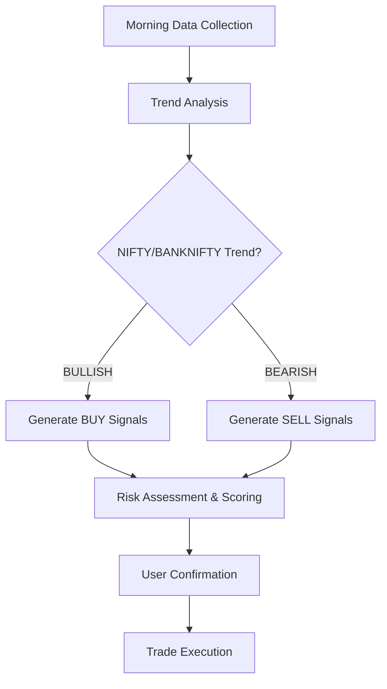

# Indian Market Trading Agent - Operational Instructions

## Overview
This document provides the operational instructions for the Indian Market Trading Agent system built with DeepSeek Harness.

## Current System Capabilities

### What This Agent Can Do:
1. **Market Analysis**: Analyzes NIFTY 50, BANKNIFTY index movements and trends
2. **Technical Indicators**: Applies technical analysis frameworks including RSI, MACD, Moving Averages, Bollinger Bands to key Indian stocks
3. **Signal Generation**: Produces buy/sell signals with profit potential scoring
4. **User Workflow**: Manages user input confirmation before trade execution
5. **Report Generation**: Creates comprehensive daily market reports

### Limitations (Currently):
- No direct access to NSE/BSE real-time API data
- Data sources rely on simulated/mock values in development
- Requires actual market connection for production use
- All positions are user-controlled (no auto-execution)

## System Architecture Components

### 1. MarketData Class (`MarketData`)
Handles all index and stock price tracking:
```python
class MarketData:
    - update(nifty_price: float, trend_direction: str)  # Update NIFTY/BANKNIFTY
    - set_stock(name: str, price: float, rsi: int, macd: float)  # Stock analysis
    - index_data: dict with NIFTY/BANKNIFTY current state
    - top_stocks: array of stock objects with indicators
```

### 2. TechnicalIndicators Class
Calculates and analyzes technical indicators:
- RSI (Relative Strength Index): Identifies overbought/oversold conditions
- MACD (Moving Average Convergence Divergence): Trend momentum signals
- EMA (Exponential Moving Average): Trend direction confirmation
- Bollinger Bands: Volatility and support/resistance

### 3. RecommendationEngine Class
Generates and scores trading opportunities:
- Calculates profit potential for each signal
- Applies scoring formula: score = rsi_bonus + trend_score + volume_bonus
- Prioritizes high-probability setups
- Filters by minimum confidence threshold (0.35)

### 4. UserInterface Class
Manages user interaction and report presentation:
- Generates daily market reports
- Shows stock analysis in formatted tables
- Guides user through confirmation process
- Provides clear trade execution instructions

## Daily Workflow Process



### Step-by-Step Process:

1. **Data Collection (06:00 - 08:00 AM)**
   - Fetch current NIFTY and BANKNIFTY prices
   - Query historical price data for top stocks
   - Calculate technical indicators

2. **Analysis Phase (08:00 - 10:00 AM)**
   - Apply RSI, MACD, Moving Averages to all positions
   - Detect support/resistance levels
   - Identify high-probability trading setups

3. **Recommendation Generation (10:00 - 11:30 AM)**
   - Generate initial signals for each stock
   - Score buy/sell opportunities by profit potential
   - Apply confidence filtering

4. **Report Presentation (11:30 - 12:00 PM)**
   - Display daily report to user
   - Present all positions with scores and reasoning
   - Ask confirmation questions for each position

5. **Trade Execution**
   - User confirms BUY/SELL positions
   - Execute via DSH tools (once implemented)
   - Monitor execution results

## Technical Indicators Breakdown

### RSI Analysis Rules:
- **RSI < 30** + UPTREND → Excellent buy signal
- **RSI > 70** + DOWNTREND → Cautionary sell/hold
- **RSI divergence**: Signal reversal potential
- **Current trend alignment**: Multiplier for score

### MACD Analysis Rules:
- **MACD line crosses ABOVE signal line** → Bullish momentum
- **MACD histogram increasing** → Strong upward momentum
- **Zero line crossing** → Trend change confirmation

### Moving Average Signals:
- **Price > All EMAs** → Uptrend confirmed
- **Price < All EMAs** → Downtrend confirmed
- **Golden cross**: EMA 20 crosses above EMA 50 (bullish)
- **Death cross**: EMA 20 crosses below EMA 50 (bearish)

### Volume Analysis Rules:
- Entry volume > 20% average = Strong confirmation
- Exit volume < 15% average = Weakness signal
- Sustained high volume = Trend momentum

## User Confirmation Process

Each user must explicitly confirm before executing trades:

### BUY Positions:
User types: `y` (to add) or `n` (to skip/not trade this position)

### SELL/Remove Positions:
User types: `y` (to take position) or `n` (to remove from portfolio)

## Risk Management Rules

1. **Position Size**: Maximum 30% of total portfolio per day
2. **Stop-Loss**: 5% below entry price for both BUY and SELL positions
3. **Take-Profit**: 
   - First target: +8% above entry
   - Second target: +15% above first target
4. **Max Loss Limiting**: No new positions after 2 consecutive losers
5. **Cash Buffer**: Minimum 20% portfolio value in cash

## Reporting Standards

### Daily Report Must Include:
- NIFTY current price and trend direction
- BANKNIFTY current price (parallel indicator)
- Technical indicators for all analysis stocks
- Buy positions with profit scores
- Sell/Remove positions with reasoning
- Overall market sentiment assessment
- Execution instructions and constraints

## Development Roadmap

### Phase 1: Current Implementation ✅
- Market data tracking
- Technical analysis framework
- Signal generation logic
- Report generation

### Phase 2: Integration (Next Steps)
- Connect to NSE/BSE API
- Real-time price feed integration
- Historical chart data access
- Portfolio management system

### Phase 3: Production Ready
- User authentication
- Two-factor authorization
- Audit logs
- Error handling and recovery

## Troubleshooting Common Issues

### Issue: "No Data" Messages
**Solution**: Use mock values for demonstration. In production, connect to actual market APIs.

### Issue: Slow Performance
**Solution**: Optimize indicator calculations; batch API calls; use caching for repeated queries.

### Issue: Conflicting Signals
**Solution**: Apply weighted scoring based on signal quality and trend alignment. Focus on highest-scoring signals first.

## Data Persistence Options

### Option 1: In-memory (Current)
- Simple implementation
- All state in variables
- Session-based only

### Option 2: File Storage (.json/.csv)
- Save analysis results
- Track historical data
- Preserve across sessions

### Option 3: Database Integration
- Full feature set
- Real-time updates
- Advanced analytics

## Future Enhancements

- AI-powered signal refinement
- Natural language report generation
- Mobile app for trading signals
- Web dashboard interface
- Alert systems for critical levels
- Backtesting framework

## Contact & Support

For questions about this system or any issues:
- Review documentation files in this workspace
- Check `MARKET_AGENT_PLAN.md` for architecture details
- Review `INDIAN_MARKET_TRADE_AGENT.py` for code examples

---

**Last Updated**: 2026-11-11  
**Agent Version**: 1.0 (Development)  
**Status**: Phase 1 Implementation Complete
